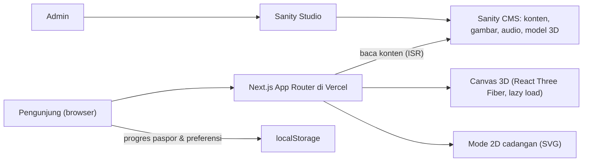

# 🇮🇩 Nusantara.go — Konsep Proyek v2.1 (3D Edition)

> **Status:** Draf untuk direview · **Sifat:** Proyek portofolio/edukasi non-komersial · **Platform:** Web responsif (desktop & mobile browser)

---

## 1. Ringkasan

**Nusantara.go** adalah **peta 3D interaktif** Indonesia bergaya ilustrasi nusantara untuk menjelajahi budaya **38 provinsi**: rumah adat, tarian, pakaian adat, kuliner, alat musik, bahasa daerah, senjata tradisional, upacara/tradisi, dan destinasi wisata budaya.

Yang membedakannya dari situs ensiklopedia biasa:
- **Memanjakan mata**: kepulauan Indonesia tampil sebagai diorama 3D yang mengapung di atas laut, dengan kamera sinematik, model 3D rumah adat yang bisa diputar, dan transisi bergerak yang halus.
- **Bisa didengar**: setiap provinsi punya sapaan bahasa daerah dan cuplikan musik tradisional.
- **Ada misi**: pengguna mengumpulkan stamp di **Paspor Budaya 3D** lewat kuis interaktif (pilihan ganda, tebak suara, tebak gambar, cocokkan).
- **Ada alasan untuk kembali**: fitur *Budaya Hari Ini* dan **Kalender Festival**.
- **Dwibahasa**: Indonesia & English.

**Target pengguna:** pelajar/Gen Z, wisatawan lokal & mancanegara, guru (sebagai media ajar), dan masyarakat umum.

**Rilis pertama fokus ke Pulau Jawa** (6 provinsi). Provinsi lain tampil di peta dengan status "Segera hadir".

---

## 2. Apa yang Berubah

| Aspek | v1 | v2.1 |
|---|---|---|
| Nama | budaya.go | **Nusantara.go** |
| Cakupan | 5–7 provinsi sampel | MVP **6 provinsi Jawa**, target akhir **38 provinsi**, 9 kategori konten |
| Peta | SVG 2D (react-simple-maps) | **Peta 3D (Three.js / React Three Fiber)** + SVG 2D sebagai cadangan |
| Gaya visual | Pastel/monokrom clean | **Diorama ilustratif nusantara**: warna tanah, motif batik/tenun, cahaya hangat |
| Motion | Framer Motion dasar | **Kamera sinematik 3D + GSAP ScrollTrigger + Framer Motion** untuk UI |
| Interaksi | Hover + klik | + Paspor 3D & kuis bervariasi, audio, jelajah acak, pencarian, kalender |
| Bahasa | Indonesia | **ID + EN** |
| Data | JSON / Supabase (belum pasti) | **Sanity CMS** (khusus pengelolaan konten oleh admin) |
| Akun | — | **Tanpa akun**: progres disimpan di browser + kode cadangan |

> [!WARNING]
> **Peta harus 38 provinsi.** Banyak file TopoJSON gratis masih 34 provinsi (sebelum pemekaran 2022: Papua Selatan, Papua Tengah, Papua Pegunungan, Papua Barat Daya). Siapkan atau sunting sendiri file peta yang sudah diperbarui sejak awal, walaupun MVP baru berisi Jawa.

---

## 3. Pengalaman 3D & Motion ✨

### 3.1 Momen-Momen Utama

| Momen | Yang dilihat pengguna | Teknik |
|---|---|---|
| **Intro sinematik** | Kamera turun dari awan, menyapu laut, lalu berhenti di atas kepulauan Indonesia. Logo Nusantara.go muncul. Bisa di-*skip* dan hanya diputar pada kunjungan pertama. | Jalur kamera (CatmullRom curve) + GSAP timeline |
| **Peta diorama 3D** | Setiap provinsi berupa "lempeng tanah" low-poly yang diekstrusi dari TopoJSON dan mengapung di atas laut bergaya ilustrasi | `ExtrudeGeometry` dari data geo, material toon/matcap |
| **Hover provinsi** | Lempeng provinsi terangkat sedikit, tepinya menyala keemasan, dan muncul label nama | Raycasting + spring animation |
| **Klik provinsi** | Kamera terbang dan mendarat ke provinsi, provinsi lain meredup, lalu panel detail meluncur masuk | Camera fly-to + Framer Motion |
| **Ikon landmark** | Miniatur 3D (Joglo, Monas, angklung, reog) melayang perlahan di atas tiap provinsi | Model glTF low-poly + animasi *float* |
| **Laut hidup** | Air bergelombang lembut dengan motif batik samar yang mengalir | Custom shader (GLSL/TSL) |
| **Suasana** | Kunang-kunang/partikel cahaya dan awan tipis yang bergerak | Instanced particles |
| **Siang ↔ malam** | Tombol mode: malam hari menampilkan lampion dan cahaya hangat dari rumah adat | Transisi lighting + bloom halus |

### 3.2 Halaman Provinsi
- **Viewer rumah adat 3D**: model bisa diputar dan di-zoom, dengan *hotspot* yang bisa diklik untuk menjelaskan bagian rumah (misalnya *saka guru* pada Joglo).
- **Scroll storytelling**: saat menggulir, kamera bergerak melewati adegan 3D kecil provinsi itu (rumah adat → panggung tari → pasar kuliner), dan teks muncul berurutan (GSAP ScrollTrigger + pinning).
- Galeri foto berlisensi tetap dipakai untuk konten detail; 3D untuk wow-factor, foto untuk keaslian.

### 3.3 Paspor Budaya 3D
- Paspor berupa buku 3D yang halamannya bisa dibalik.
- Saat lulus kuis, ada animasi **cap stempel ditekan** (squash & stretch, partikel tinta, dan bunyi "tok!").

### 3.4 Prinsip Motion
- **Bermakna, bukan pamer**: setiap gerakan membantu orientasi (di mana saya, apa yang bisa diklik).
- **Durasi**: mikro-interaksi 150–250 ms, transisi kamera 1,2–1,8 s dengan *ease-in-out*; animasi keluar ~75% dari durasi masuk.
- **`prefers-reduced-motion`**: intro dilewati, kamera berpindah langsung tanpa terbang, partikel mati.

### 3.5 Performa & Aksesibilitas 3D

> [!IMPORTANT]
> 3D yang indah tapi patah-patah justru merusak kesan. Target: **60 fps di laptop menengah, ≥ 30 fps di HP menengah**.

- **Tingkat kualitas otomatis** (tinggi / sedang / rendah) dengan `PerformanceMonitor` + `AdaptiveDpr`, serta pilihan manual di pengaturan.
- **Mode 2D cadangan** (peta SVG) untuk perangkat lemah, browser tanpa WebGL, pembaca layar, atau pengguna yang memilihnya.
- Model 3D dikompresi (**Draco/Meshopt + tekstur KTX2**). Anggaran: ≤ 300 KB per landmark, ≤ 2 MB untuk scene awal.
- Canvas 3D di-*lazy load*; teks dan konten penting dirender HTML biasa (bukan di dalam canvas), sehingga SEO dan aksesibilitas tetap terjaga.
- Saat diam, render dihentikan (`frameloop="demand"`) agar hemat baterai.
- Peta 3D tetap bisa dinavigasi dengan keyboard (Tab antarprovinsi, Enter untuk membuka).

---

## 4. Fitur

### 4.1 Peta Interaktif
- Peta 3D seperti dijelaskan di bagian 3, dengan mode 2D cadangan.
- Provinsi yang kontennya belum tersedia tampil redup dengan label **"Segera hadir"**.
- Filter kategori di peta, misalnya "tampilkan semua tarian", sehingga ikon landmark berganti sesuai kategori.
- Halaman provinsi punya URL sendiri (`/id/provinsi/jawa-barat`) agar bisa dibagikan dan diindeks Google.

### 4.2 Panel / Halaman Provinsi
Tab per kategori: Rumah Adat · Tarian · Pakaian · Kuliner · Alat Musik · Bahasa · Senjata · Upacara · Wisata.
Setiap item berisi foto, deskripsi singkat, fakta unik, **sumber & atribusi lisensi**, dan lokasi (untuk wisata).

### 4.3 🔊 Audio Budaya
- Sapaan khas saat provinsi dibuka (misalnya "Sampurasun" untuk Jawa Barat, "Sugeng rawuh" untuk Jawa Tengah/DIY).
- Cuplikan musik tradisional 15–30 detik (angklung, gamelan, gambang kromong, dll.).
- Efek suara halus untuk interaksi (hover, stempel, balik halaman).
- **Tidak autoplay**, ada tombol mute global, dan preferensinya diingat.

### 4.4 🛂 Paspor Budaya (Gamifikasi)
Setiap provinsi punya **kuis 5 soal** dengan jenis soal campuran:

| Jenis soal | Contoh |
|---|---|
| **Pilihan ganda** | "Tari Jaipong berasal dari provinsi mana?" |
| **Tebak suara** | Putar audio, lalu pilih alat musiknya (angklung / gamelan / gambang kromong) |
| **Tebak gambar / model 3D** | Tampilkan rumah adat yang berputar, lalu tebak namanya |
| **Cocokkan** | Tarik kuliner ke provinsi asalnya (gudeg → DIY, rawon → Jawa Timur) |

- Lulus (≥ 4/5 benar) berarti mendapat **stamp** di Paspor 3D.
- Halaman Paspor: koleksi stamp, progres per pulau, dan lencana (misalnya "Penjelajah Jawa", "Nusantara Lengkap 38/38").
- Disimpan di **localStorage**, tanpa akun, dengan **kode cadangan** ekspor/impor.
- Kartu hasil yang bisa dibagikan ke media sosial.

### 4.5 🎲 Jelajah Acak & Budaya Hari Ini
- Beranda menampilkan satu item budaya yang berganti tiap hari.
- Tombol "Kejutkan Aku": kamera terbang ke provinsi atau item acak.

### 4.6 🔍 Pencarian Lintas Kategori
- Ketik "Gudeg", "Reog", atau "Angklung", lalu hasilnya muncul dan kamera menyorot provinsi asal.
- Toleran salah ketik (*fuzzy*) dan dwibahasa.

### 4.7 📅 Kalender Festival & Upacara Adat
- Contoh untuk Jawa: Grebeg Maulud & Sekaten (DIY), Seba Baduy (Banten), Yadnya Kasada (Jawa Timur), Dieng Culture Festival (Jawa Tengah), Lebaran Betawi (DKI).
- Klik acara untuk menuju provinsi di peta.
- Acara yang tanggalnya **berubah tiap tahun** (kalender Jawa/Hijriah/adat) diberi label "perkiraan".

### 4.8 🌐 Dwibahasa
- Prefix URL `/id` dan `/en`, tombol ganti bahasa, dan konten CMS punya kolom ID & EN.

---

## 5. Arsitektur & Tech Stack

| Lapisan | Pilihan | Alasan |
|---|---|---|
| Framework | **Next.js (App Router) + TypeScript** | SSG/ISR untuk SEO halaman provinsi, optimasi gambar |
| Styling | **Tailwind CSS** + token warna nusantara | Cepat dan konsisten |
| 3D | **three.js + @react-three/fiber + @react-three/drei** | Ekosistem 3D paling matang untuk React |
| Efek 3D | **@react-three/postprocessing** | Bloom, vignette, depth of field yang halus |
| Data geo → 3D | **d3-geo** (proyeksi) + `ExtrudeGeometry` | Mengubah TopoJSON menjadi lempeng 3D |
| Motion scroll & kamera | **GSAP + ScrollTrigger + @gsap/react** | Timeline sinematik dan scroll storytelling |
| Motion UI | **Framer Motion (Motion)** | Panel, modal, transisi halaman |
| Smooth scroll | **Lenis** | Scroll halus yang sinkron dengan ScrollTrigger |
| Peta 2D cadangan | **react-simple-maps** | Ringan dan aksesibel |
| Drag & drop | **dnd-kit** | Soal cocokkan, mendukung sentuhan & keyboard |
| UI primitif | **Radix UI** | Aksesibel |
| CMS | **Sanity** | Studio siap pakai, field i18n, CDN untuk gambar/audio/glTF |
| i18n | **next-intl** | Routing `/id` `/en` |
| Pencarian | **Fuse.js** + indeks JSON saat build | Gratis, cepat, fuzzy |
| Audio | **Howler.js** | Sprite efek suara + musik, kontrol volume global |
| State | **Zustand + persist** | Paspor, preferensi kualitas 3D/audio/bahasa |
| Pipeline aset 3D | **Blender → gltf-transform** (Draco/Meshopt, KTX2) | Model kecil dan cepat dimuat |
| Deploy | **Vercel** | Gratis untuk proyek non-komersial |

---

## 6. Model Data (ringkas)

- **Provinsi**: `slug`, `nama{id,en}`, `ibukota`, `pulau`, `status` (tersedia/segera), `posisiLandmark3D`, `modelLandmark` (glTF), `warnaTema`, `sapaanAudio`, `musikAudio`, `deskripsi{id,en}`
- **ItemBudaya**: `provinsi→`, `kategori` (9 jenis), `nama{id,en}`, `deskripsi{id,en}`, `faktaUnik`, `gambar[]`, `model3D?`, `hotspot3D[]?`, `audio?`, `sumber`, `lisensi`, `lokasi?`
- **Kuis**: `provinsi→`, `soal[]` dengan `jenis` (pilihanGanda / tebakSuara / tebakGambar / cocokkan), `pertanyaan{id,en}`, `media?`, `opsi[]`, `jawabanBenar`
- **Acara**: `nama{id,en}`, `provinsi→`, `tanggalMulai`, `tanggalSelesai`, `tanggalPerkiraan:boolean`, `deskripsi`, `sumber`

---

## 7. Arah Visual

- **Konsep:** *"Diorama Nusantara"*, seperti miniatur kepulauan buatan tangan yang hidup di meja seorang pengrajin.
- **Palet:** terakota, cokelat soga, krem kertas, hijau daun, biru laut kehijauan, dan aksen emas kunyit.
- **Material 3D:** low-poly dengan shading toon/matcap yang lembut (bukan realistis), selaras dengan gaya ilustrasi.
- **Tekstur:** motif batik/tenun beropasitas rendah di laut, bingkai panel, dan Paspor. Untuk Jawa: kawung, parang, mega mendung.
- **Tipografi:** serif berkarakter untuk judul (misalnya *Fraunces*) + *Plus Jakarta Sans* untuk isi.
- **Signature detail:** tepi provinsi yang menyala keemasan saat hover dan animasi cap stempel paspor.
- **Aksesibilitas:** kontras WCAG AA, navigasi keyboard, mode 2D, transkrip untuk soal suara, dan menghormati `prefers-reduced-motion`.

---

## 8. Konten, Aset 3D & Lisensi

- **Model 3D** (rumah adat, landmark, alat musik): dibuat di Blender, diambil dari Sketchfab/Poly Pizza berlisensi CC, atau dibuat dengan generator 3D AI lalu dirapikan. Semua model ditampilkan dengan atribusinya.
- **Ilustrasi** (ikon, stamp, motif): dibuat sendiri atau dengan bantuan AI lalu dirapikan.
- **Foto & audio**: Wikimedia Commons, Openverse, Freesound, portal Kemdikbud/Indonesiana, dengan **atribusi wajib**.
- **Akurasi**: setiap item mencantumkan sumber. Untuk budaya yang dikenal di beberapa daerah (batik, wayang, gamelan), tulis "dikenal di…".

### Cakupan MVP: Pulau Jawa

| Provinsi | Contoh konten | Landmark 3D |
|---|---|---|
| **Banten** | Rumah Baduy, Debus, golok Ciomas, Seba Baduy | Rumah Baduy |
| **DKI Jakarta** | Rumah Kebaya, Ondel-ondel, gambang kromong, kerak telor | Monas / Ondel-ondel |
| **Jawa Barat** | Imah Julang Ngapak, Jaipong, angklung, kujang | Angklung |
| **Jawa Tengah** | Joglo, Tari Gambyong, gamelan, keris, lumpia | Candi Borobudur |
| **DI Yogyakarta** | Bangsal Kencono, Tari Bedhaya, gudeg, Grebeg Maulud | Tugu Jogja / Joglo |
| **Jawa Timur** | Rumah Joglo Situbondo, Reog Ponorogo, celurit, rawon | Topeng Reog |

> [!NOTE]
> Contoh di atas masih ilustratif. Setiap item tetap perlu diverifikasi dari sumber saat input konten.

**Beban MVP:** sekitar 54–80 item konten, 6 landmark 3D + 6 model rumah adat, 6 set kuis (30 soal), dan ±10 acara.

---

## 9. Skill yang Dipakai

### 9.1 Skill yang Sudah Anda Miliki

| Fase / pekerjaan | Skill |
|---|---|
| Brief, token desain, arah visual | `brief`, `tokens`, `ui-craft`, `high-end-visual-design`, `design-taste-frontend`, `typeset`, `colorize` |
| Perencanaan aset visual & 3D | `visual-content-director`, `imagegen-frontend-web` |
| Scene 3D (peta, laut, landmark) | `threejs-fundamentals`, `threejs-shaders`, `threejs-interaction`, `threejs-animation`, `threejs-postprocessing` |
| Motion & scroll storytelling | `gsap-scrolltrigger`, `gsap-performance`, `animate`, `emil-design-eng`, `find-animation-opportunities`, `animation-performance`, `improve-animations` / `review-animations` |
| Responsif & aksesibilitas | `adapt`, `audit`, `web-design-guidelines`, `harden` |
| Kualitas & rilis | `critique`, `finalize`, `launch-readiness-auditor`, `deploy-orchestrator` |

### 9.2 Skill Tambahan yang Direkomendasikan (hasil `find-skills`)

| Skill | Kegunaan | Sumber & popularitas |
|---|---|---|
| `cloudai-x/threejs-skills@threejs-react-three-fiber` | Pola React Three Fiber (inti proyek) | 9,9K installs |
| `cloudai-x/threejs-skills@threejs-performance` | Optimasi 3D agar lancar di HP | 10,1K installs |
| `cloudai-x/threejs-skills@threejs-materials` | Material toon/matcap untuk gaya diorama | 24,6K installs |
| `cloudai-x/threejs-skills@threejs-lighting` | Cahaya hangat & mode siang/malam | 22,7K installs |
| `cloudai-x/threejs-skills@threejs-geometry` | Ekstrusi provinsi dari data peta | 23,7K installs |
| `greensock/gsap-skills@gsap-core` | Dasar GSAP (resmi GreenSock) | 98,5K installs |
| `greensock/gsap-skills@gsap-timeline` | Timeline kamera sinematik | 90,9K installs |
| `greensock/gsap-skills@gsap-react` | GSAP di React/Next.js | 86,1K installs |
| `vercel-labs/agent-skills@vercel-react-best-practices` | Praktik terbaik React/Next.js (resmi Vercel) | 935K installs |
| `wshobson/agents@nextjs-app-router-patterns` | Pola App Router | 34,9K installs |
| `sanity-io/agent-toolkit@sanity-best-practices` | Praktik terbaik Sanity (resmi) | 35,6K installs |
| `sanity-io/agent-toolkit@content-modeling-best-practices` | Desain schema konten (resmi) | 5,3K installs |
| `github/awesome-copilot@next-intl-add-language` | Menambah bahasa dengan next-intl | 9,4K installs |

> [!NOTE]
> Skill Framer Motion dan "WebGL performance" yang ditemukan kurang populer (kebanyakan < 100 installs) atau sudah tercakup oleh skill yang Anda miliki (`animate`, `animation-performance`), jadi tidak direkomendasikan.

---

## 10. Roadmap Bertahap

| Fase | Isi | Hasil |
|---|---|---|
| **0. Fondasi** | Setup Next.js, Tailwind, next-intl, Sanity + schema, TopoJSON 38 provinsi, brief & token desain, pipeline aset 3D | Kerangka berjalan |
| **1. Peta 3D Jawa** | Diorama 3D (ekstrusi provinsi, laut shader), hover/klik/fly-to, mode 2D cadangan, halaman provinsi, konten 6 provinsi | Bisa didemokan |
| **2. Wow Layer** | Intro sinematik, landmark 3D, viewer rumah adat + hotspot, scroll storytelling, siang/malam | Memanjakan mata |
| **3. Gamifikasi & Audio** | Kuis 4 jenis soal, Paspor 3D + animasi stempel, ekspor/impor progres, audio & efek suara | Fitur pembeda utama |
| **4. Penemuan & Kalender** | Pencarian fuzzy, Budaya Hari Ini, Jelajah Acak, filter kategori, kalender festival | Mudah dijelajahi |
| **5. Poles & Rilis v1.0 (Jawa)** | Versi EN, audit performa 3D & aksesibilitas, SEO (sitemap, OG image per provinsi) | Rilis publik |
| **6. Ekspansi** | Per pulau: Bali & Nusa Tenggara → Sumatra → Kalimantan → Sulawesi → Maluku & Papua | 38 provinsi |

---

## 11. Risiko & Mitigasi

| Risiko | Mitigasi |
|---|---|
| 3D berat / patah-patah di HP | Tingkat kualitas otomatis, kompresi Draco/KTX2, anggaran ukuran aset, mode 2D |
| Pembuatan model 3D memakan waktu | Mulai dari 6 landmark sederhana; gaya low-poly; manfaatkan model CC dan generator AI |
| Konten 3D tidak terbaca mesin pencari | Konten penting tetap HTML; canvas hanya lapisan visual |
| Volume konten besar | Mulai dari Jawa; template entri di Sanity; ekspansi per pulau |
| Lisensi foto/audio/model | Hanya sumber CC/PD; field atribusi wajib di CMS |
| Audio alat musik sulit dicari | Freesound/Wikimedia; siapkan soal cadangan jenis lain |
| Progres hilang (tanpa akun) | Ekspor/impor kode cadangan |
| Tanggal festival tidak pasti | Label "perkiraan" + tautan sumber resmi |

---

## 12. Keputusan yang Sudah Dikonfirmasi

- ✅ Nama: **Nusantara.go**
- ✅ MVP: **6 provinsi Pulau Jawa**
- ✅ Visual: **3D + motion sinematik**, gaya diorama ilustratif nusantara
- ✅ Kuis bervariasi: pilihan ganda, tebak suara, tebak gambar/model 3D, cocokkan
- ❌ Kontribusi pengguna: **tidak ada**
- ✅ Tanpa akun, progres di browser
- ✅ Dwibahasa ID/EN, web saja
